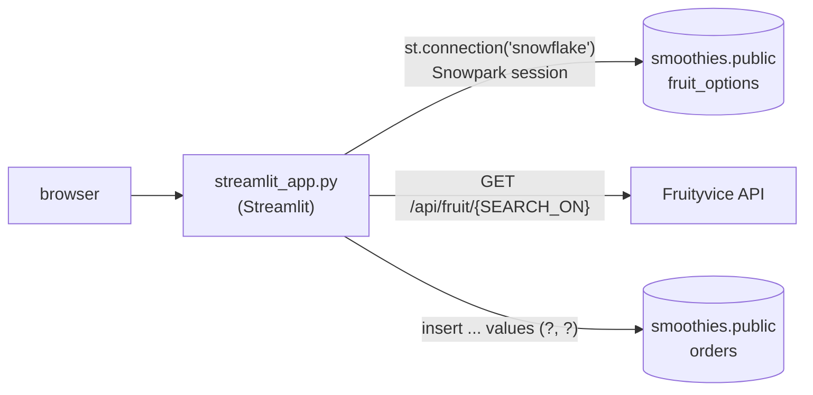

# Melanie's Smoothies

A small Streamlit order form backed by Snowflake. You name a smoothie, pick up to five fruits, see nutrition data
for each one from the public [Fruityvice](https://fruityvice.com) API, and submit the order into a Snowflake
table. I built it in June 2024 while working through a Snowflake and Streamlit course; "Melanie's Smoothies" is
the exercise's scenario, not a real shop, and no real orders go through it. It stays public as a record of a
first data app: one script that reads from a warehouse, calls an outside API and writes back.

## At a glance

| | |
|---|---|
| **Status** | Finished course project (2024). Small maintenance fixes in November 2026 (dependency update, SQL parameter binding). |
| **Stack** | Python, Streamlit 1.54.0, Snowflake Snowpark, pandas, requests |
| **Run it** | `pip install -r requirements.txt && streamlit run streamlit_app.py`. Needs your own Snowflake account and tables ([Quick start](#quick-start)). |
| **Verified** | 2026-11-09 against `main` at `085d8ef`: full app flow run headless against a stubbed Snowflake session and the live Fruityvice API. Not run against a real Snowflake account ([how](#testing-and-ci)). |

## Why this exists

The question behind the exercise is how small a real data application can be: one that reads reference data
from a warehouse, enriches it from a third-party API, and writes a transaction back, with no backend server of
its own. Streamlit plus a Snowpark session answers that in about 50 lines.

Building it surfaced the problems that make even a tiny app like this non-trivial, and they shape the code:

- **Where the app runs decides how it connects.** It started inside Snowflake (Streamlit in Snowflake, which
  hands the script an active session). Running it as a standalone web app meant switching to
  `st.connection("snowflake")`, with credentials configured outside the repository.
- **Display names are not API keys.** Fruit names in the menu ("Apples") don't always match the API's search
  terms ("Apple"). Rather than hard-coding a mapping in Python, the menu table carries a `SEARCH_ON` column,
  so the data owner can fix a lookup without a code change.
- **User text must never become SQL.** The 2024 version built the `INSERT` by string concatenation, so a name
  like `O'Brien` broke the statement and a crafted name could change it. The November 2026 fix binds both
  values as parameters.

## What works today

| capability | status | how it was verified |
|---|---|---|
| Fruit menu loaded from `smoothies.public.fruit_options` (`FRUIT_NAME`, `SEARCH_ON`) | Working with a stub | headless run on 2026-11-09 with a stubbed Snowpark session: the multiselect showed the stub's three fruits |
| Multiselect limited to 5 fruits | Working | `max_selections=5` in [`streamlit_app.py`](streamlit_app.py); Streamlit enforces it in the widget |
| Nutrition table per chosen fruit from Fruityvice | Working | same run, real API calls: one subheader and one table per fruit; `GET https://fruityvice.com/api/fruit/watermelon` returned 200 on 2026-11-09 |
| Order insert into `smoothies.public.orders` with bound parameters | Working with a stub | same run: name `O'Brien` + 2 fruits produced `values (?, ?)` with params `['Apples Watermelon ', "O'Brien"]` and the success message |
| Against a real Snowflake account | Not verified | no Snowflake credentials on the verification machine; the repo holds none by design |
| Hosted copy | Unknown | the repo description calls this "the web version of the smoothie order form", but nothing in the repo records a live deployment |
| Input checks, API error handling | Not built | an empty name is accepted; a Fruityvice error or slow response isn't handled (no timeout) |

## Quick start

**Requirements:** Python 3.10+ (checked with 3.12), and a Snowflake account with:

- a database `smoothies`, schema `public`;
- a table `fruit_options` with columns `FRUIT_NAME` and `SEARCH_ON`;
- a table `orders` with at least `ingredients` and `name_on_order` columns;
- a Streamlit connection named `snowflake`, for example in `.streamlit/secrets.toml` under
  `[connections.snowflake]`. Keep that file out of git; no credentials are stored in this repository.

```bash
git clone https://github.com/AlexRosen23/melanies_smoothies.git
cd melanies_smoothies
python3 -m venv .venv && source .venv/bin/activate
pip install -r requirements.txt
streamlit run streamlit_app.py      # opens http://localhost:8501
```

**Expected result:** a "Customize Your Smoothie!" page. Choosing fruits shows a nutrition table for each, and
Submit Order writes one row to `orders` and shows "Your Smoothie is ordered!".

Without a working Snowflake connection the page renders the title and name box, then stops at
`st.connection("snowflake")` with an error (checked headless on 2026-11-09). A real Snowflake account is the only
part I couldn't run on the verification machine.

## How it works



One run of the script, top to bottom (Streamlit re-runs it on every interaction):

1. Read the smoothie name from a text box.
2. Open the Snowpark session from `st.connection("snowflake")`, select `FRUIT_NAME` and `SEARCH_ON` from
   `fruit_options`, and convert the result to a pandas DataFrame.
3. Offer the fruit names in a multiselect (at most 5).
4. For each chosen fruit, look up its `SEARCH_ON` value, call Fruityvice, and render the JSON as a table.
5. Show the order summary and a Submit Order button. On click, run the parameterized `INSERT` through
   `session.sql(..., params=[...])` and show a success message.

Everything is in [`streamlit_app.py`](streamlit_app.py).

## How it was built

The 2024 history is 26 small commits made in GitHub's web editor (committer `GitHub`) on June 17–18, 2024. They
trace the course's steps:

| step | commits | what changed |
|---|---|---|
| Streamlit in Snowflake | `74d5db3` | first version: `get_active_session()`, fruit multiselect, `INSERT` built by string concatenation |
| Standalone app | `76be090`, `e6e6c1f`, `ceeaccb` | `st.connection("snowflake")` replaces the in-Snowflake session; `requirements.txt` replaces a conda-style environment file |
| Nutrition data | `789c2ac`, `1057f6d` | Fruityvice call, first hard-coded to watermelon, then one call and table per chosen fruit |
| Name-to-search mapping | `d549cf5`, `d11670f` | pandas DataFrame of the menu, then the `SEARCH_ON` column used for the API lookup |
| Small fix | `bdef37a` | no leading space in the ingredients string |

Two changes in November 2026, both made with Claude Code:

- [PR #2](https://github.com/AlexRosen23/melanies_smoothies/pull/2): consolidated dependency update
  (Streamlit pinned 1.31.1 → 1.54.0), replacing Dependabot's [PR #1](https://github.com/AlexRosen23/melanies_smoothies/pull/1).
- [PR #3](https://github.com/AlexRosen23/melanies_smoothies/pull/3): the `INSERT` binds its two values instead of
  pasting them into the SQL (a SQL-injection fix).
- [PR #4](https://github.com/AlexRosen23/melanies_smoothies/pull/4) and this PR: README rewrites.

## Limitations and what's next

- **No validation.** An empty name or an empty order can be submitted (the button only appears once a fruit is
  chosen, but the name isn't checked).
- **No API error handling.** `requests.get` has no timeout, and an error response from Fruityvice is rendered as
  if it were nutrition data or fails the page.
- **Deprecated parameter.** Streamlit 1.54 warns that `use_container_width` should become `width="stretch"`.
- **Ingredients stored as one space-separated string** with a trailing space, as the course's table design
  expects. A real order system would store one row per ingredient.
- **No tests in the repo.** If revisited: add the checks above and commit the headless test described below.

## Repository map

| path | what it is |
|---|---|
| `streamlit_app.py` | the whole app: UI, Snowflake reads, Fruityvice calls, order insert |
| `requirements.txt` | Python dependencies (Streamlit pinned to 1.54.0) |
| `README.md` | this file |

## Testing and CI

There is no test suite in the repo. For this README (2026-11-09) I ran the app headless with Streamlit's
`AppTest` (Streamlit 1.54.0, Python 3.12): `st.connection` was replaced with a stub whose session returns a
three-fruit menu and records SQL calls. The run typed the name `O'Brien`, chose two fruits (real Fruityvice
calls), clicked Submit Order, and checked the rendered tables, the success message and the recorded `INSERT`
with its bound parameters. No exceptions. The only warnings were the `use_container_width` deprecation. The
stub and test script are not committed.

GitHub Actions is enabled on this repository, but it has no workflow files, so nothing runs.

## Related

- [Fruityvice API](https://fruityvice.com) (public, no key).
- [Streamlit connections](https://docs.streamlit.io/develop/api-reference/connections/st.connection).
- No license file is included, so default copyright applies.
